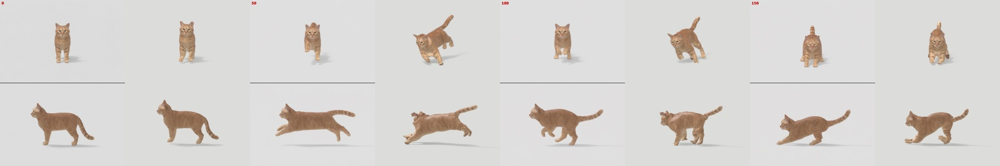
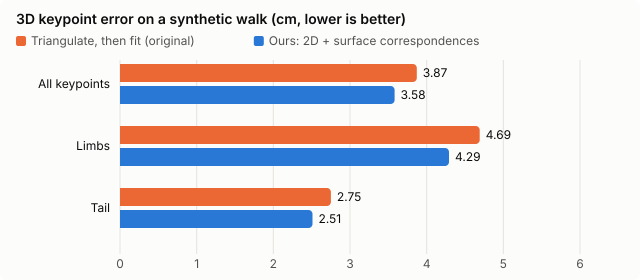

# QuadMocap

Motion capture for **rigged quadrupeds** from AI-generated two-view videos, as a local one-click web app.
You give it a rigged animal; it renders a start frame for a video model (e.g. Seedance), trains a keypoint detector on
synthetic renders of *your* rig, and fits the rig to the generated video. Output: a Blender action, `.blend` and FBX.

[中文说明](README_zh.md)



*Example cat, frames 0 / 50 / 100 / 150. In each pair: left = Seedance video, right = fitted rig. The result is **not perfect** — see [Limitations](#limitations).*

## Credit

The workflow comes from the YouTube video by **Can It Code?** —
[“AI Can Now Animate Any Monster”](https://www.youtube.com/watch?v=AS92HYsEBqo): generate a two-view video with a video
model, detect keypoints with a DINO-based model trained on synthetic renders of the rig, triangulate, and fit the skeleton.
This repository is an independent re-implementation with the changes listed below. It is not affiliated with the video author.

## What we changed

| | Original workflow (as we understood it) | This repo |
|---|---|---|
| Fitting target | Triangulate 3D points from the two views, then fit bones to the 3D points | Fit bones **directly to the 2D detections in both views** (reprojection error), no triangulation step |
| Signal | Sparse keypoints | Keypoints **+ dense surface correspondences**: the head also predicts, per pixel, the rest-pose position on the mesh; those pixels are matched to mesh vertices (KD-tree) and the skinned vertices are fitted too |
| Video drift | — | The video model's front panel drifts (zoom / moves toward the camera). The fitter solves a **smooth per-frame scale + vertical shift** for the front panel |
| Evaluation | — | **Synthetic ground-truth benchmark**: render the rig's own animation with the same cameras, run the whole pipeline, measure 3D error |
| Rig | One creature | **Any rigged quadruped** through one JSON config (bone names, keypoints, joint limits, helper bones, orientation) |

Other details: bone lengths are fixed (only joint rotations are solved), joint-limit / smoothness / floor terms,
whole-sequence joint optimisation, and badly deformed synthetic samples (edge stretch) are dropped from training.

### Comparison data

Same detections, same rig, only the fitting method differs (`fit.py --mode ours` vs `--mode triangulate`).

**Synthetic walk, 120 frames, ground truth known** (mean 3D keypoint error after aligning the pelvis, cm):

| Method | All keypoints | Limbs | Tail |
|---|---|---|---|
| Triangulate, then fit (original) | 4.38 | 5.29 | 3.60 |
| **Ours** (2D + surface, drift correction) | **3.63** | **4.41** | **2.86** |



About 17 % lower error overall. Data and script: [`examples/cat/benchmark`](examples/cat/benchmark),
`python src/eval_synth.py ...` (see the README there). The pelvis itself (always 0 after alignment) is excluded.
A fresh end-to-end re-run with `src/synth_benchmark.py` (walk cycle, every 2nd frame, new render and detection) gives
the same picture: ours 3.53 / 4.30 / 2.65 cm vs. triangulation 4.41 / 5.28 / 3.64 cm (all / limbs / tail).

**Real Seedance video (example cat, 193 frames)** — no ground truth, so this is the median 2D distance between the fitted
rig's keypoints and the detections (px, 834×556 panels):

| Method | Front panel | Side panel |
|---|---|---|
| Triangulate, then fit | 10.4 | 8.3 |
| **Ours** | **10.2** | **7.2** |

## Requirements

- Windows 10/11 or Linux, NVIDIA GPU with CUDA (tested: RTX 5060 Ti 16 GB). Training uses a few GB of VRAM.
- [Blender](https://www.blender.org/) 4.2 or newer (tested 5.1.2), used headless as an external program.
- Python 3.10–3.12.
- Put the repo and your project files on a path **without non-ASCII characters** (OpenCV cannot read such paths on Windows).

## Install

Windows: run `setup.bat` (creates `.venv`, installs CUDA PyTorch and the requirements, downloads DINOv2-base into `weights/`).

Manual:
```bash
python -m venv .venv
.venv/Scripts/python -m pip install torch torchvision --index-url https://download.pytorch.org/whl/cu128
.venv/Scripts/python -m pip install -r requirements.txt
.venv/Scripts/python src/download_weights.py
```

## Use the web app

Run `start.bat` (or `python app/server.py`) and open http://127.0.0.1:7860. The app only listens on localhost.
If Blender is not found automatically, set its path under **Settings**. Each step shows progress and the log.

1. **Import rig** — upload a `.blend` / `.fbx` / `.glb` with one armature and its skinned mesh(es). The scene is cleaned
   (other objects removed, transforms applied, meshes joined) and a **draft config** is guessed from the bone names
   (left/right tokens, orientation, keypoints at bone heads and chain ends, feet). Review it in the config editor —
   especially joint limits; the defaults are generic. If the file has an animation (e.g. a walk cycle), it is used as a
   pose prior for the synthetic data.
2. **Start frame** — renders the start image: top = front view, bottom = left side, same orthographic scale, plus
   `cameras.json`. Give the image to an image-to-video model as the first frame.
3. **Render training data** — random poses inside the joint limits, two views each: RGB, a rest-position map and
   keypoint labels. ~0.5 s per sample per Blender process; 1500 samples is a good start.
4. **Train** — frozen DINOv2 backbone, small convolutional head (6000 steps ≈ 30 min on an RTX 5060 Ti).
5. **Upload video → Detect + fit → Preview → Export** — detection overlay, fitted-vs-source comparison video,
   `mocap.blend` and `mocap.fbx` (baked action, for Unreal / Unity / other DCCs).

To try it without training: **New project → Copy example: cat**. It ships with a trained head, the start frame and the
test video, so you can go straight to step 5.

### Making the video

Use the start frame as the first frame of an image-to-video model. Ask for both panels to stay in sync and for the
camera to stay fixed. The prompt used for the example video (Seedance, originally in Chinese):

> Top and bottom panels must stay completely in sync. The kitten starts standing, then runs happily with proud, relaxed
> steps, then stops…

The video must keep the start frame's layout (top = front, bottom = side). Any resolution with the same aspect ratio
works; the cameras are scaled by width.

## Command line

Every step is a plain script; the app only runs these.

```bash
blender -b rig.blend --python src/bl_prep.py -- PROJECT              # import / clean / draft config
blender -b PROJECT/rig/clean.blend --python src/bl_start_frame.py -- PROJECT
blender -b PROJECT/rig/clean.blend --python src/bl_render.py -- PROJECT START COUNT SEED
python src/train.py --project PROJECT
python src/predict.py --project PROJECT --src video.mp4 --out PROJECT/videos/x/det
python src/fit.py --project PROJECT --pred PROJECT/videos/x/det/pred.npz --out PROJECT/videos/x/fit [--mode triangulate]
blender -b PROJECT/rig/clean.blend --python src/bl_apply.py -- PROJECT PROJECT/videos/x/fit blend|fbx|render [W H]
python src/compose_compare.py video.mp4 PROJECT/videos/x/fit
python src/synth_benchmark.py --project PROJECT --blender path/to/blender   # synthetic ground-truth benchmark
```

## Rig config

One JSON per project (`PROJECT/config.json`); full example: [`examples/cat/config.json`](examples/cat/config.json).

| Field | Meaning |
|---|---|
| `armature`, `mesh` | Object names. `mesh` may be a list (joined on import). |
| `orientation` | `forward`: world axis the animal faces (`-Y` for the cat), `left`: axis its left side points to (`+X`). |
| `side_tokens` | e.g. `["_L_", "_R_"]` or `[".L", ".R"]`; used for symmetric pose sampling. |
| `keypoints` | `[name, bone, end]`, `end` = `"head"`, `"tail"` or 0–1 along the bone. Names starting with `l_` / `r_` are drawn in left/right colours. |
| `skeleton` | Keypoint pairs, only for drawing. |
| `foot_keypoints` | Kept above the floor during fitting. |
| `joint_limits` | `[{"match": regex, "limits": [[lo,hi],[lo,hi],[lo,hi]] or null}]`, degrees, first match wins, `null` = no own rotation. Axes are the bone's XZY Euler: x = bend, y = twist around the bone, z = sideways. |
| `default_limits` | Limits for bones no rule matches. |
| `helper_bones` | `[{"match": regex, "source": replacement, "factor": 0.5}]`: bones that copy a fraction of another bone's rotation (e.g. half-angle wrist helpers). |
| `smooth_chains` | `[{"match": regex, "amp_deg": [x, z]}]`: chains (tails) sampled as one smooth curve. |
| `start_frame` | Panel size, camera tilt, ortho width and aim height (`null` = derived from the mesh size). |
| `render`, `train`, `fit`, `video` | Sample count, Blender workers, training steps / backbone, fitting weights, front-drift correction, video layout and fps. |

## Example: our cat

[`examples/cat`](examples/cat) is a complete project: the rigged cat (`rig/source.blend`, 53 bones, with a walk cycle as
pose prior), its config, the trained detector head, the start frame and cameras, the Seedance test video, the detection
overlay, the comparison video, the fitted result (`mocap.blend`, `mocap.fbx`) and the synthetic benchmark data.
The 1500-sample training set (~850 MB) is not included; step 3 regenerates it.

The cat model was generated with [Tripo](https://www.tripo3d.ai/) from photos of the author's own cat and rigged by hand.
See [`examples/cat/README.md`](examples/cat/README.md) for its attribution.

## Limitations

The example result is **not perfect**:

- **Tail** is the weakest part (largest residuals); in the front panel the tail sits too high.
- **Airborne frames** of the run float slightly too high.
- **No foot locking** yet, so feet can slide during contact.
- During the run (about frames 50–110) the fitted body **turns in the front view** while the source cat stays frontal.
  The video model's front panel also drifts (≈5 % zoom); the drift correction absorbs part of it.
- The detector was trained on 1500 synthetic samples only; synthetic-test error is 9.8 px mean / 4.2 px median
  (448 px crops), worst on tail tip and hind toes.
- Generic-rig support has been tested on the cat and on a procedural blocky test rig
  ([`tests/make_test_rig.py`](tests/make_test_rig.py): `.L/.R` names, other facing axis, scaled object, two meshes) —
  not yet on many real rigs. The draft config's joint limits are generic and usually need editing.

## Swapping the backbone (DINOv3)

The backbone is loaded with `transformers.AutoModel`, so DINOv3 works once you have access:
`python src/download_weights.py --model facebook/dinov3-vitb16-pretrain-lvd1689m` (gated: accept the license on
Hugging Face and log in first), then set `"train": {"backbone": "weights/dinov3-vitb16-pretrain-lvd1689m"}` and retrain.

## Third-party software and services

- **DINOv2** (Meta) — Apache-2.0, weights downloaded from Hugging Face, not included.
- **Blender** — GPL, called as an external program; not bundled.
- **Seedance** (ByteDance) — external video-generation service used to make the example video; not part of this repo.
- **Tripo** — used to generate the example cat model.
- PyTorch, Hugging Face Transformers, OpenCV, SciPy, FastAPI, Uvicorn, imageio-ffmpeg — see their licenses.

## License

Code: [MIT](LICENSE). The example cat assets have their own note in [`examples/cat/README.md`](examples/cat/README.md).
